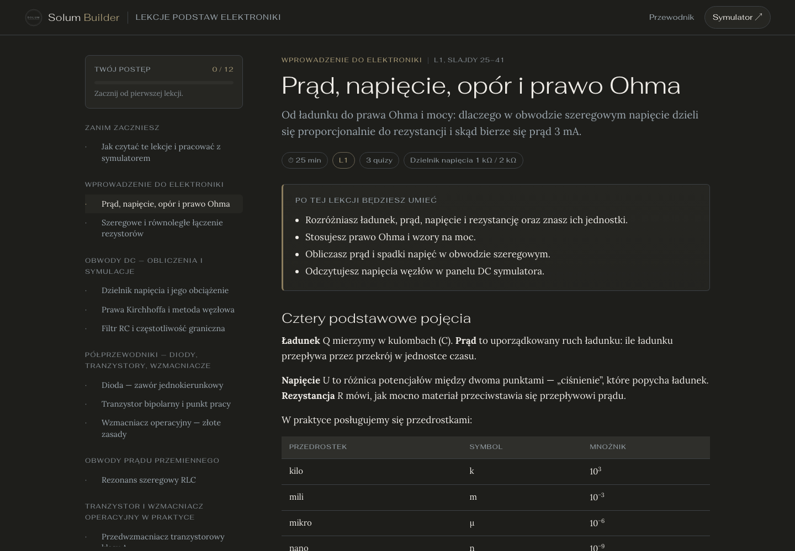
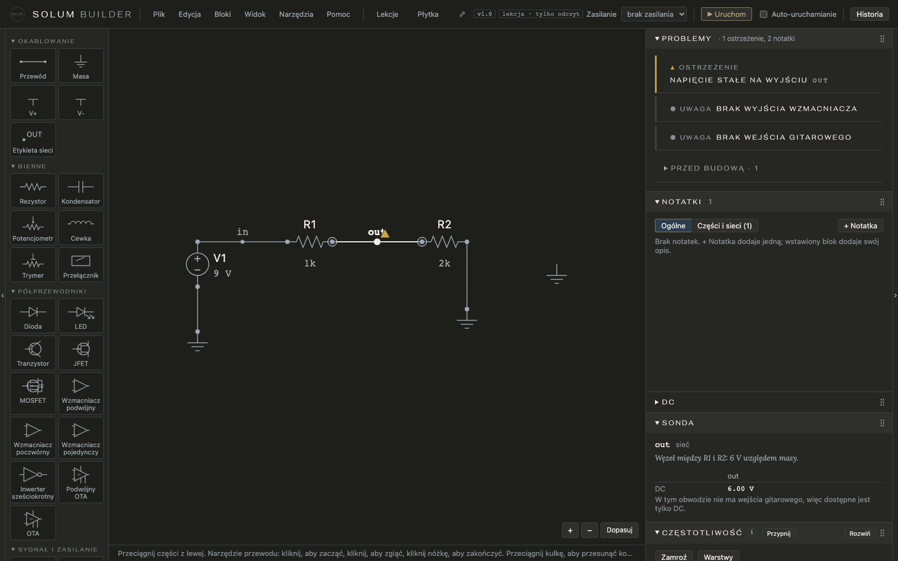

# Solum Builder PL — interaktywne lekcje podstaw elektroniki

Polski fork [Solum Builder](https://github.com/pbexiga/solum-builder) z kursem
**12 lekcji** opartym na wykładach *Podstawy elektroniki* (L1, L3, L4, L5, L6).

Symulator robi to, co oryginał: rysujesz obwód, klikasz dowolny punkt, widzisz napięcie,
przebieg i charakterystykę częstotliwościową, kręcisz pokrętłami i sprawdzasz reguły.
Ten fork dokłada do tego polski interfejs i **lekcje**, w których każdy wzór kończy się
obwodem do uruchomienia w symulatorze.





## Co nowego względem oryginału

- **Kurs `Lekcje`** pod adresem `/lekcje/` — 12 lekcji, 12 gotowych obwodów, quizy,
  zadania i postęp zapisywany w przeglądarce.
- **Polski interfejs symulatora** — nagłówek, menu, paleta części, panele, ostrzeżenia
  i najczęstsze komunikaty. Tłumaczenie działa warstwą (`web/i18n.js`), więc nie zmienia
  logiki ani plików obwodów.
- **Obwody lekcji** w `library/lessons/circuits/` i generator `scripts/build_lesson_circuits.py`.
- **Treść lekcji** w `library/lessons/*.yaml` — Markdown + wzory + quizy, bez zewnętrznego
  CMS-a.
- **Testy kursu** w `tests/unit/test_lessons.py` — sprawdzają spójność plików YAML i obwodów.

## Szybki start

### Docker (zalecane)

```bash
git clone https://github.com/Wierzciu/solum-builder.git
cd solum-builder
docker compose up
```

Otwórz:

- lekcje: <http://localhost:8000/lekcje/>
- symulator: <http://localhost:8000/>

Obraz zawiera ngspice 44.2, czyli wersję, z którą projekt był testowany.

### Ze źródeł (macOS/Linux)

Wymagania: Python 3.12+, `libngspice` (najlepiej 44.2) i `make` (opcjonalnie).

```bash
python3 -m venv .venv
. .venv/bin/activate
pip install -e ".[dev]"

# macOS z Homebrew: wskaż bibliotekę ngspice
export NGSPICE_LIBRARY=/opt/homebrew/lib/libngspice.dylib
PORT=8000 solum serve
```

Na macOS Homebrew instalacji bywa **ngspice 47**, a projekt był budowany pod **44.2**.
Proste obwody lekcji (DC, RC, dioda, tranzystor) działają, ale bardziej złożone układy
z modelami (np. TS808) mogą zwrócić „Nie udało się wczytać obwodu do symulatora”.
W takim wypadku użyj Dockera albo zbuduj ngspice 44.2 lokalnie:

```bash
curl -L -o ngspice-44.2.tar.gz \
  "https://downloads.sourceforge.net/ngspice/ng-spice-rework/44.2/ngspice-44.2.tar.gz"
tar xzf ngspice-44.2.tar.gz
cd ngspice-44.2
./configure --prefix="$PWD/../ngspice44" --with-ngshared --disable-debug --without-x
make -j8 && make install
export NGSPICE_LIBRARY="$PWD/../ngspice44/lib/libngspice.dylib"
```

## Mapa kursu

| # | Lekcja | Wykład / slajdy | Obwód |
|---|---|---|---|
| 1 | Jak czytać lekcje i pracować z symulatorem | wstęp | dzielnik z potencjometrem |
| 2 | Prąd, napięcie, opór i prawo Ohma | L1, 25–41 | 9 V, 1 kΩ, 2 kΩ |
| 3 | Szeregowe i równoległe łączenie rezystorów | L1, 21–23, 40–41 | 1 kΩ + (2 kΩ ∥ 2 kΩ) |
| 4 | Dzielnik napięcia i jego obciążenie | L3, 12–15 | 10 kΩ / 10 kΩ + 10 kΩ |
| 5 | Prawa Kirchhoffa i metoda węzłowa | L3, 23–37 | dwa źródła, trzy rezystory |
| 6 | Filtr RC i częstotliwość graniczna | L3, 18–22; L5, 2–4 | 10 kΩ, 100 nF |
| 7 | Dioda — zawór jednokierunkowy | L4, 2–9 | obcinacz 1N4148 |
| 8 | Tranzystor bipolarny i punkt pracy | L4, 10–16 | wspólny emiter z trymerem |
| 9 | Wzmacniacz operacyjny — złote zasady | L4, 17–28 | odwracający −2 na TL071 |
| 10 | Rezonans szeregowy RLC | L5, 12–26 | 100 Ω, 10 mH, 1 µF |
| 11 | Przedwzmacniacz tranzystorowy klasy A | L6, 2–23 | CE o wzmocnieniu ≈ 10 |
| 12 | Sumator odwracający jako przetwornik DAC | L6, 24–28 | 1 V + 2 V + 4 V = −7 V |

Każda lekcja ma:

- cele w formie „po tej lekcji będziesz umieć”,
- teorię z wzorami i tabelami,
- obwód otwierany w symulatorze (jako przykład tylko do odczytu; *Plik → Zapisz jako…*
  tworzy Twoją kopię),
- zadania do wykonania w panelach **DC**, **Sonda**, **Częstotliwość**, **Oscyloskop**,
- quizy z wyjaśnieniem każdej odpowiedzi,
- zapis postępu w `localStorage` (bez konta i bez chmury).

## Jak dodać lub zmienić lekcję

Treść lekcji to plik YAML w `library/lessons/`. Minimalny przykład:

```yaml
id: moja-lekcja
order: 120
lecture: L6
lecture_title: Tranzystor i wzmacniacz operacyjny w praktyce
title: Moja nowa lekcja
slides: "L6, slajdy 1–5"
minutes: 20
summary: "Jedno zdanie o tym, czego uczy lekcja."
objectives:
  - "Pierwszy cel."
circuit: moj-obwod
circuit_title: Mój obwód
blocks:
  - type: text
    md: |
      Treść w Markdownie. Wzory w linii: <div class="formula-line">U = I · R</div>
  - type: circuit
    circuit: moj-obwod
    title: "Obwód do lekcji"
    md: |
      Opis układu.
    tasks:
      - "Uruchom symulację i odczytaj napięcie `out`."
  - type: quiz
    question: "Pytanie?"
    options: ["Odpowiedź A", "Odpowiedź B"]
    answer: 1
    explain: "Dlaczego B jest poprawne."
```

Dostępne typy bloków: `text`, `formula`, `note` (tony `info`, `tip`, `warn`), `circuit`,
`quiz`, `table`. Pełny schemat i walidacja są w `solum/lessons.py`.

Obwody rysuje się kodem w `scripts/build_lesson_circuits.py` (klasa `Drawing` z projektu):
części mają ręcznie dobrane położenia, przewody idą pin-do-pinu, a `net_differences`
porównuje rysunek z zamierzonym netlistem. Po zmianie:

```bash
.venv/bin/python scripts/build_lesson_circuits.py
.venv/bin/python .claude/skills/draw-circuit/look.py \
  library/lessons/circuits/moj-obwod.json   # podgląd PNG i ostrzeżenia
```

## Polski interfejs

Tłumaczenie jest warstwą w `web/i18n.js`:

- słownik `PL` mapuje dokładne napisy interfejsu,
- `RULES` obsługuje komunikaty z danymi („Saved X (v1.0)”, „1 warning, 2 notes”),
- `MutationObserver` tłumaczy też menu i panele tworzone później,
- tekst użytkownika (nazwy obwodów, notatki, wartości) nie jest ruszany, bo słownik
  dopasowuje tylko znane napisy.

Aby zmienić tłumaczenie, dopisz parę w `PL`. Głębokie strony wbudowanego przewodnika
(`/manual/`) pozostają po angielsku — to dokumentacja upstreamu; kurs i interfejs są polskie.

## Różnice techniczne

- `solum/lessons.py` — walidacja i renderowanie lekcji (Pydantic + markdown-it).
- `solum/api/app.py` — `/api/lessons`, `/api/lessons/{id}`, `/api/lessons/{id}/circuit`,
  nowa warstwa pliku `lesson` (tylko odczyt).
- `web/app.js` — obsługa adresu `#lesson/<id>`.
- `web/lekcje/` — strona kursu (bez frameworka i bez bundlera, jak reszta projektu).
- `library/lessons/` — treść i obwody.
- `web/i18n.js` — polska warstwa interfejsu.

## Testy

```bash
.venv/bin/python -m pytest tests/unit/test_lessons.py -q
.venv/bin/ruff check solum/lessons.py scripts/build_lesson_circuits.py tests/unit/test_lessons.py
.venv/bin/mypy --strict solum/lessons.py
PATH="$PWD/.venv/bin:$PATH" ./scripts/jscheck.sh
```

Pełny zestaw upstreamu: `make check` (wymaga Dockera/Podmana i ngspice 44.2).

## Licencja i źródła

Projekt jest forkiem [pbexiga/solum-builder](https://github.com/pbexiga/solum-builder),
licencja **MIT z Commons Clause** — szczegóły w [`LICENSE`](LICENSE). Kurs korzysta
z materiałów *Podstawy elektroniki* (wykłady L1, L3, L4, L5, L6); obwody lekcji są
własnymi, prostymi układami dydaktycznymi, a nie kopiami schematów z podręczników.

Ngspice, uPlot, czcionki Fahkwang i Lora oraz modele SPICE zachowują swoje licencje —
zobacz [`THIRD-PARTY-NOTICES.md`](THIRD-PARTY-NOTICES.md).

---

**English:** this is a Polish educational fork. The simulator is upstream Solum Builder;
the Polish course, lesson circuits and UI translation are added here. See the upstream
[README.upstream.md](README.upstream.md) for the original project and its full documentation.
